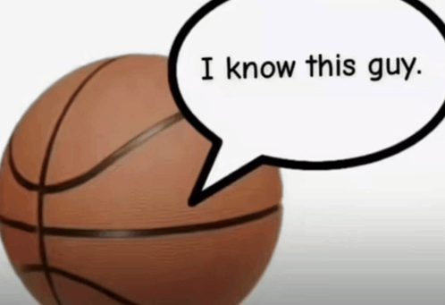

# internet-lore
A project in which I will try to create a map to relate everything noteworthy or famous on the internet
For now the license is "The Unlicense", later I'll look into using a Creative Commons license.

The main idea is to create a 2D map connected by nodes, ordered from top to bottom by year, showing the origins of internet content. For example (I still need to upload it):
* Parrot kawaii music video minecraft `Related to Minecraft` -> Shibayan Records - Tiny Little Adiantum (deadman 死人 Remix) [Omae Wa Mou] `Related to anime? (I dont think so, only the GIF has the anime thing and idk if its official)` -> タイニーリトル・アジアンタム `Related to TouHou` -> PoFV - Yuka Kazami's Theme - Gensokyo, Past and Present ~ Flower Land `Sorry but again related to TouHou`
* Random memes videos outros/intros -> Megumin - nachi `Related to Konosuba (yeah, bakuretsu lalala, and more memes, chunchunmaru` -> 【ShibayanRecords】Fly Out! Bankikki (Casual Killer remix)【Subbed】`RELATED TO Touhou (it means also linked and those nodes have a connection)`
* Gabriel Dancing [IOSYS] 04. サードアイや 〜 3rd eye `Gabriel DropOut anime (it will have connections to other famous memes, for example: https://www.youtube.com/watch?v=xhmhM-BO2HY or https://youtu.be/OYEwFxoJduY?t=89 (which is also connected to a TF2 meme...) )` -> IOSYS - Third Eye now! `touhou` -> Knife Party - Bonfire [Music Video]
*Nyan Cat! [Official] `Momo vocaloid version is the famous one, so it gives a connection to vocaloid and momo` -> Nyan Cat Hatsune Miku version (the original version if I'm not mistaken) `Also connects to Vocaloid and Hatsune Miku`

(I know that many of these examples are related to Touhou; they're the ones I'm most familiar with and that come to mind first, but you can see where my idea is going.)

This repository will also include the original files in the best possible quality as a way to preserve the material. In cases where the material isn't complete, for example, Bad Apple, it's fine to upload several versions trying to cover as much as possible, but without overdoing it. Three versions for Bad Apple, for example, are good since we have the YouTube PV version, a version with parts of the concert filling in the missing sections, and the version recreated by the community.

Since I'm Spanish, it's possible that the memes and things I post won't be as popular in communities outside of Spain/Latin America (I'm referring to my contributions).

Contributions will have to be made via pull requests, and I'd like them to be as accurate and complete as possible.

How will the data be displayed? My idea is to perhaps generate a static HTML website that allows you to navigate the map. I want it to be easy to access. This idea seems good to me because with GitHub Actions, page releases can be automated to keep it updated, and since it's a website, anyone can quickly view the entire map.

If possible, when including the date of release, please be as precise as possible: day, month, year. If it's something that happens very quickly, add details to the description about the time it was released and what happened that same day in the following hours. (Should we use UTC+0?)

Example of how the above should look once rendered (first idea):  

Perhaps it would be better to make the icons smaller? (We'll see.) Also, it's possible that the lines could pass behind the signs, and the lines will be semi-transparent so as not to be distracting.
If something doesn't have images or anything like that, just adding the initials will serve as a "photo or preview."  
First things first. We need to collect the data and store it in a structure that's easy for humans to add and modify entries, and also easy for the code to work with. Here, the complexity won't matter since it can take any amount of time to process before the action is released, even if the algorithm for relationships and page layout is O(n^3), which isn't that extreme.  
I would love for this to last much longer in the future, as a way to look back on it. The internet is a huge thing, and we've had the incredible opportunity to grow with its creation. Gam gam style, Google, Amazon, YouTube, tusecreto.io, slither.io, Netscape, Firefox, Chrome, Windows XP, Windows 7, Windows 10, Fortnite events, Minecraft, GTA 5, FNAF, osu!, Reddit, Instagram, 4chan, SCP, Discord, Sony Vegas, Photoshop, After Effects, AMV, Bad Apple, Touhou, MMD, Vocaloid, Get Down, Doom, Neon Genesis Evangelion, Kill la Kill, Love Live! (Nico Nico Niii), Nekomonogatari (See nooo~~ [Renai Circulation]), Dab, Bottle Flip Challenge, Dragon Ball, Naruto, Steins;Gate, Attack on Titan, Jujutsu Kaisen, Oshi no Ko, Yasobi, NoCopyrightSounds, TheFatRat, NightCore, Skrillex, Tame Impala, Cyberpunk Death Note, Rascal Does Not Dream of Bunny Girl Senpai, Super Idol 105º, xue hua piao piao bei feng xiao xiao, PIKOTARO - PPAP (Pen Pineapple Apple Pen), Vaporewave, MACINTOSH PLUS - リサフランク420 /現代のコンピュー, MrSuicideSheep, glue70 casin, Bag Raiders - Shooting Stars, Camel By Camel, Phao - 2 Phut Hon, AJR - World's Smallest Violin, caramelldansen, My Ordinary Life - The Living Tombstone, nichijou, Biggie Smalls feat. Thomas the Tank Engine, Doki Doki, Kasane Teto, [HQ] An Enigmatic Encounter V2 - Undertale Last Breath (Phase 3), Triple Baka, Kikuo - Aishite Aishite Aishite, Musicaly (that converted to TikTok and if im not wrong it may come fromanother, but i dont remember the name), TikTok, PS2, Wii, Nintendo DS+3DS, Wii U, Counter Strike, Half Life, Steam, KevinMacLeod, Digital Circus, Mario Kart, Emulators, 2B2T, Adobe Flash Player, Wayback Machine, Skype, Feacebook, La Grasa :v, Friv, happy wheels, Everyday Normal Guy 2, Minecraft 1.9 Combat update, Herobrine, Blender, Cinema4D, .exe, Guys vs Girls, World pre 2020 vs post 2020, "The great shift"+Now anime is main stream, Rat kids (mostly minecraft), No Mercy, Overwatch, Rule34, Google Translator, AI, NCNN, GAN, DAIN, RIFE, NERF, Gaussian Splatting, ESRGAN, Real-ESRGAN, Diffusion, Stable Diffusion, Bitcoin, Transformer, LLM, GPT, ChatGPT 3.5, Google Bard, Google Palm, Meta Llama 2, Feacebook -> Meta, DeepSeek-V3, Tenor, CUDA, NVIDIA, AMD, INTEL, Chika Dance, chicken jockey, End Update, Nether Update, Covid, Epstein, Trump, Google+LG Nexus 5, VLC, Subnautica, Pixel Gun 3d, ARK, Bongo Cat, Portal, VRChat, Terraria, Beat Saber, NekoPara, Unrecord (the game made in UE5), Kerbal Space Program, Undertale, Deltarune, Human Fall Flat, The Coffin of Andy and Leyley, Project Zomboid, Stick Fight.  

This is just a small part of the things that have affected the internet. These are things that more experienced users, those who have spent more time on it, know. And although it might not seem like it, there are connections between them. And we wouldn't even need to add all the memes and lore surrounding them. The internet is enormous. The moment those of us who know these relationships die, it will be very difficult to connect everything. There are things that aren't even written down; they are experiences that haven't been recorded. I hope this project works and inspires you. EVERY contribution will be a great help.  

By the way, if for some reason you know and have context for most of the things above (to be honest, I haven't included so many older things because they don't come to mind right now; for example, I left out Troll Face, Troll Song, rage comics (Trollface, LOL Guy, Forever Alone, Fuck Yeah, Cereal Guy). Sorry, too much text... Well, if you know the things above, then you're a real internet geek.  

